# Início — tela inicial estilo Apple TV para Android TV

Um launcher (tela inicial) para Android TV / Google TV com a cara da Apple TV e tudo o que ajuda a
**decidir o que assistir**: notas do IMDb, onde cada título está no Brasil, "O que assistir agora?",
busca em português do jeito que a gente fala e avisos quando algo da sua lista chega a um streaming seu.

Feito e testado numa Sony BRAVIA (Android 10, 1080p, 2,3 GB de RAM). Gratuito e de código aberto.

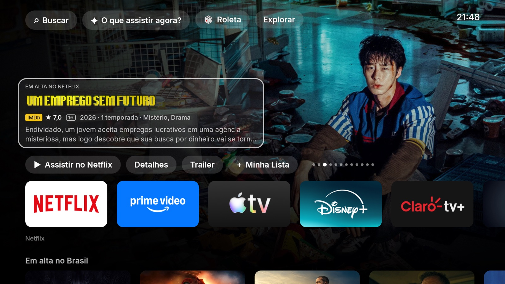

## Fotos

| | |
|---|---|
| 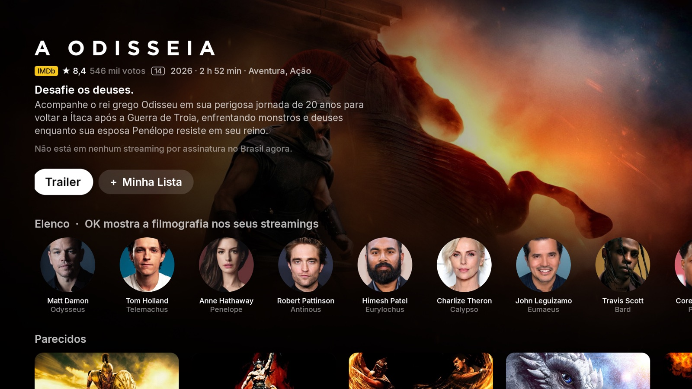 | 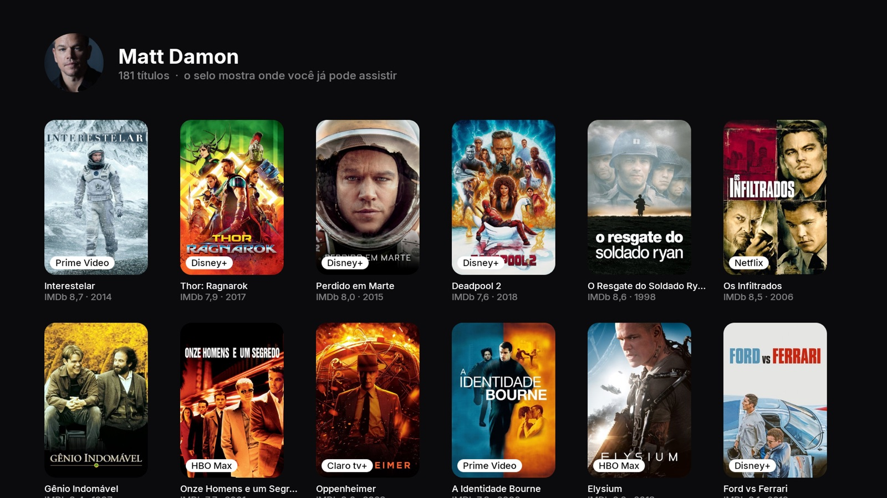 |
| **Página do título**: IMDb com votos, onde assistir, elenco e parecidos | **Filmografia**: o selo mostra em qual dos seus apps cada filme está |
| 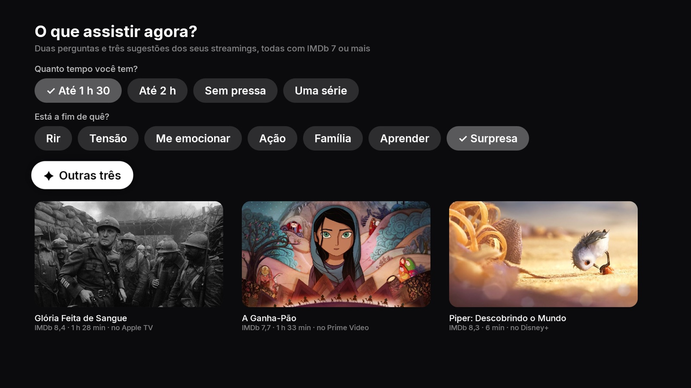 | 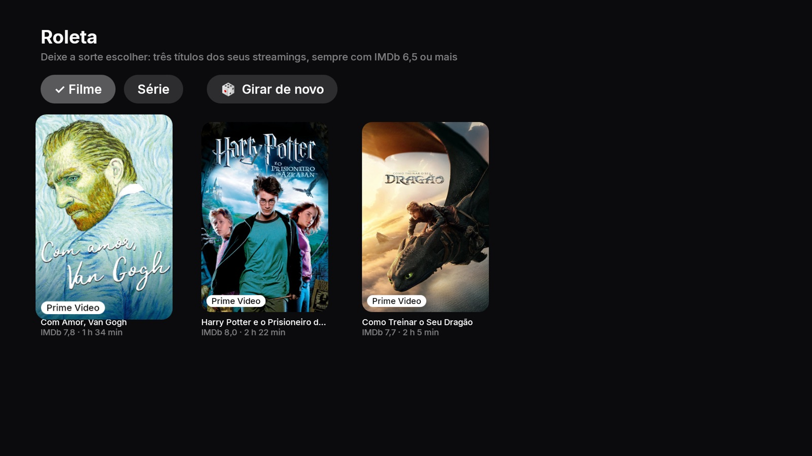 |
| **O que assistir agora?**: tempo + clima → três sugestões | **Roleta**: três títulos sorteados com IMDb 6,5+ |
| 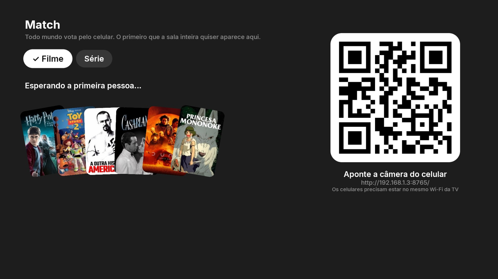 | 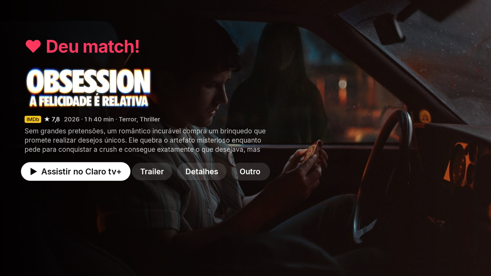 |
| **Match**: cada um entra pelo QR code no celular | **Deu match!**: o título que todos curtiram |
| 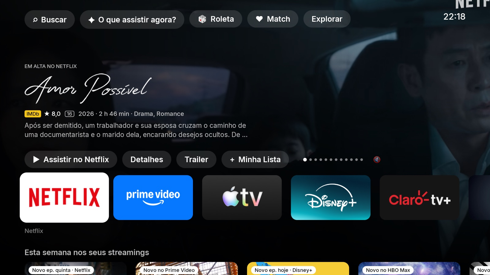 | 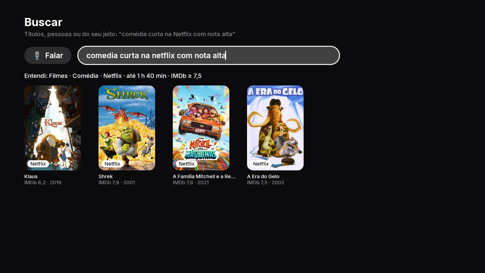 |
| **Trailer no fundo**, sem som (🔇) | **Busca**: "comédia curta na Netflix com nota alta" |
| 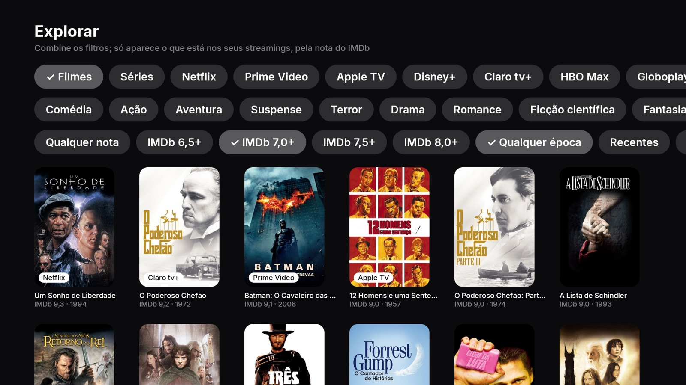 | 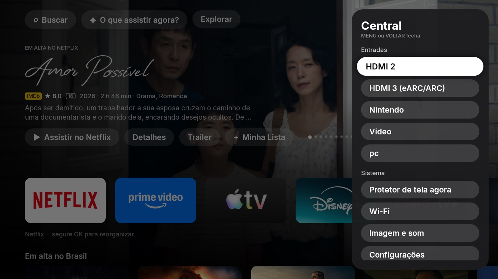 |
| **Explorar**: filtros por app, gênero, nota e época | **Central** (tecla MENU): entradas HDMI e ajustes |
|  | |
| **Protetor de tela**: o da Sony, com o clima da semana | |

---

## O que ele faz

| | |
|---|---|
| **Top Shelf em tela cheia** | Ao focar a Netflix, o topo mostra o que está em alta **na Netflix Brasil**; o mesmo para Prime Video, Disney+, Max, Globoplay, Apple TV e Claro tv+. Logotipo do título, nota do IMDb, classificação, duração, gêneros e sinopse. |
| **Assistir direto no título** | "Assistir no Netflix" abre a **página da série/filme** dentro do app (Netflix, Prime Video, Disney+, Apple TV), usando os códigos abertos do Wikidata. Globoplay e Max abrem já na busca pelo nome. O Claro tv+ vem com os links desligados de fábrica: ele abre no início e o Início avisa o nome para procurar. |
| **Trocar o título na mão** | Do app, **▲** seleciona o título do topo; aí **◀ ▶** passam para o anterior/próximo e **OK** assiste. As teclas ◀◀ ▶▶ do controle também trocam. |
| **Trailer no fundo** | Parou num título, em poucos segundos o trailer começa a tocar sem som atrás do texto, como na Apple TV, e depois de ~30 s volta para a imagem e segue. **Play/Pause** no controle liga o som. |
| **Match pelo celular** | A TV mostra um QR code; cada pessoa abre no celular (sem instalar nada), desliza os pôsteres como no Tinder, e o primeiro título que **a sala inteira** curtir aparece na TV com "Deu match!". Funciona com quantas pessoas quiserem: se ninguém concordar até o fim do baralho, aparece **o mais votado** ("7 de 10 curtiram"). "Outro match" segue para o próximo sem perder os votos. Tudo na sua rede Wi-Fi, sem nuvem. |
| **Social** (em construção) | Salas de jogos para a turma: a TV é o palco e cada celular, sem instalar nada, guarda o segredo e registra o voto. Já tem **Quem é Mais Provável?**; o plano de 15 jogos está em [`docs/social/PLANO.md`](docs/social/PLANO.md) e o que já funciona em [`docs/social/STATUS.md`](docs/social/STATUS.md). Cada celular é reconhecido quando volta, e a TV guarda um ranking geral de todas as noites (rosto só se a pessoa pedir; dá para apagar tudo). Tudo na sua rede Wi-Fi, sem nuvem. |
| **Esta semana nos seus streamings** | Séries com episódio novo nos próximos dias e filmes que acabaram de chegar aos seus apps: "Novo ep. quinta · Netflix", "Novo no Prime Video". |
| **Verde da casa** | Telas e botões levam um verde-oliva escuro (`Accent.Wall` em `ui/theme/Accent.kt`; troque a cor ali para combinar com a sua sala). |
| **Roleta** | Escolha **Filme** ou **Série** e gire: três rolos estilo caça-níquel param em três títulos dos seus streamings (de apps diferentes), sempre com IMDb 6,5 ou mais. |
| **Fileira de apps com o foco do tvOS** | O cartão cresce, inclina na direção do controle e recebe um brilho. Segure OK para reorganizar: ◀ ▶ move, ▼ oculta, OK conclui. |
| **O que assistir agora?** | Duas perguntas (quanto tempo você tem e o que está a fim) e três sugestões dos **seus** streamings, todas com IMDb 7 ou mais. |
| **Busca por voz e em português** | "comédia curta na Netflix com nota alta", "suspense dos anos 90", "série de terror na max", "filmes com o Wagner Moura". Ele mostra o que entendeu: *Filmes · Comédia · Netflix · até 1 h 40 min · IMDb ≥ 7,5*. |
| **Explorar** | Filtros de filme/série, streaming, gênero, nota mínima no IMDb, época e duração, ordenados pela nota do IMDb. |
| **Página do título** | IMDb com número de votos, onde assistir no Brasil, trailer, elenco e parecidos. Clicar num ator mostra a filmografia com o selo do app onde você já pode ver cada filme. |
| **Minha Lista com avisos** | Uma checagem diária marca "Agora no Prime" quando o título chega a um streaming que você tem, e "Novo ep. sexta" em séries. |
| **Casa** | Uma fileira logo abaixo dos apps com as luzes da casa (interruptores Tuya/Zigbee), as mais usadas primeiro: **OK** acende ou apaga na hora, e o que alguém liga na parede ou no celular aparece sozinho. A TV fala direto com o hub na sua rede, sem nuvem. **Ver a casa** tem atalhos (apagar tudo, apagar ou acender um cômodo) e filtros (acesas, luzes, cenas, por cômodo). **Botão amarelo** (ou a tecla que você escolher): a mesma Casa por cima do filme, em qualquer app. |
| **Central (tecla MENU)** | Entradas HDMI com os nomes que você deu na TV, protetor de tela, Wi-Fi e configurações. |
| **Protetor de tela** | O da própria TV ("Decoração do Ambiente" da Sony, tema **Relógio da floresta tropical**: costelas-de-adão na água, com a hora). O Início escreve por cima, sem moldura, o **clima da semana** que a Sony não tem no Brasil (Open-Meteo, cidade descoberta pela internet, sem conta). Começa depois de 3 minutos sem usar a TV. |

---

## Passo a passo para instalar

Você vai precisar de: um computador (macOS, Linux ou Windows) na mesma rede Wi-Fi da TV, e uns 20 minutos.

### 1. Ligue a depuração na TV (ADB)

1. Na TV: **Configurações → Preferências do dispositivo → Sobre**.
2. Desça até **Versão** (ou "Build") e aperte **OK 7 vezes**, até aparecer "Você é um desenvolvedor".
3. Volte e entre em **Preferências do dispositivo → Opções do desenvolvedor**.
4. Ligue **Depuração USB** e, se existir, **Depuração por rede / ADB pela rede**.
5. Anote o **endereço IP** da TV: **Configurações → Rede e Internet → (sua rede)**. Exemplo: `192.168.1.3`.

### 2. Instale as ferramentas no computador

- **ADB** (para falar com a TV): [Android Platform Tools](https://developer.android.com/tools/releases/platform-tools).
  No macOS com Homebrew: `brew install --cask android-platform-tools`.
- **Java 17**: [Temurin 17](https://adoptium.net/temurin/releases/?version=17).
- **Android SDK** (só a linha de comando, não precisa do Android Studio):
  [Command line tools](https://developer.android.com/studio#command-line-tools-only). Depois de descompactar:

  ```sh
  sdkmanager "platform-tools" "platforms;android-35" "build-tools;35.0.0"
  ```

  Quem já tem o Android Studio pode pular esta parte.

Conecte na TV (troque pelo IP dela). Na primeira vez, a TV pergunta se autoriza o computador: escolha **Sempre permitir** e OK.

```sh
adb connect 192.168.1.3:5555
adb devices          # deve listar a TV como "device"
```

### 3. Crie a sua chave do TMDB (grátis, 3 minutos)

> **E a chave do IMDb?** Não precisa. As notas do IMDb vêm do
> [arquivo público e gratuito do IMDb](https://developer.imdb.com/non-commercial-datasets/), que o app
> baixa sozinho todo dia. A única chave necessária é a do **TMDB**, de onde vêm capas, sinopses,
> elenco, trailers e "onde assistir".

1. Crie uma conta em **[themoviedb.org/signup](https://www.themoviedb.org/signup)** e confirme o e-mail.
2. Já logado, abra **[themoviedb.org/settings/api](https://www.themoviedb.org/settings/api)**
   (Avatar → **Configurações** → **API**).
3. Clique em **Criar** / **Request an API Key** e escolha **Developer**.
4. Aceite os termos e preencha o formulário. Para uso pessoal vale:
   - *Type of use*: **Personal**
   - *Application name*: `Início TV`
   - *Application URL*: `http://localhost`
   - *Application summary*: `Tela inicial pessoal para minha TV`
   - Endereço e telefone: os seus.
5. Na página de API vão aparecer duas coisas. **Copie a do meio, chamada "API Read Access Token"**
   (um texto longo que começa com `eyJ`). Ela é a que o app usa. A "API Key" curta não serve aqui.

Guarde esse token como uma senha: não publique nem mande em mensagens.

### 4. Baixe o projeto e coloque a chave

```sh
git clone https://github.com/jeancatarina/atv-home.git
cd atv-home
```

Crie um arquivo chamado **`local.properties`** na pasta do projeto com o caminho do SDK e o token:

```properties
sdk.dir=/caminho/para/o/android-sdk
tmdb.token=eyJhbGciOiJIUzI1NiJ9....(o seu token inteiro)
```

- macOS com Homebrew: `sdk.dir=/usr/local/share/android-commandlinetools` (Intel) ou
  `/opt/homebrew/share/android-commandlinetools` (Apple Silicon).
- Android Studio: geralmente `~/Library/Android/sdk` (macOS) ou `C:\\Users\\VOCÊ\\AppData\\Local\\Android\\Sdk` (Windows).

O `local.properties` já está no `.gitignore`: o token nunca vai para o GitHub.

### 5. Compile e instale na TV

```sh
./gradlew :app:assembleRelease          # no Windows: gradlew.bat :app:assembleRelease
adb -s 192.168.1.3:5555 install -r app/build/outputs/apk/release/app-release.apk
```

### 6. Use como tela inicial

Aperte **HOME** no controle. A TV pergunta qual tela inicial usar: escolha **Início** e depois **Sempre**.

Se você tinha outro launcher (Projectivy, por exemplo) e a pergunta continuar voltando, desative o
outro (não apaga nada, e volta com `pm enable`):

```sh
adb shell pm disable-user --user 0 com.spocky.projengmenu
```

### 7. Protetor de tela

O protetor é o da Sony ("Decoração do Ambiente"); o Início só põe o clima da semana por cima. Se
um "debloat" removeu os apps da Sony, devolva-os (não apaga nada) e escolha o protetor e os 3 minutos:

```sh
adb shell pm install-existing com.sony.dtv.livingfit     # Decoração do Ambiente (o protetor)
adb shell pm install-existing com.sony.dtv.sonyselect    # de onde ele baixa os temas
adb shell pm enable com.sony.dtv.timers
adb shell settings put secure screensaver_components com.sony.dtv.livingfit/.MainDreamService
adb shell settings put system screen_off_timeout 180000
```

Abra **Decoração do Ambiente** nos apps, aperte **OK** e escolha **Rainforest Clock**. O clima
aparece pelo serviço de acessibilidade do Início (o mesmo da Casa no filme), que
`tools/ad-guard-setup.sh` ou `tools/tuya-setup.sh` deixam ligado.

A Alexa liga e desliga a TV pelo app **Controle da TV com alto-falantes inteligentes** da Sony. Ele
também não pode estar desativado: `adb shell pm enable com.sony.dtv.seeds.iot`.

---

## Como usar

- **◀ ▶** na fileira de apps troca o Top Shelf para o app focado.
- **▲** a partir de um app seleciona o título do topo: **◀ ▶** trocam o filme, **OK** assiste no app.
- **▼** do título chega aos botões (Assistir, Detalhes, Trailer, Minha Lista). Lá em cima ficam
  **Buscar**, **O que assistir agora?**, **Roleta** e **Explorar**.
- **Segurar OK** num app: modo de edição (◀ ▶ mover, ▼ ocultar, OK concluir). Apps ocultos ficam no fim da tela; segure OK para mostrar de novo.
- **MENU**: Central com as entradas HDMI. **VOLTAR** fecha qualquer tela.

## Casa (luzes Tuya)

A fileira **Casa** acende e apaga as luzes dos interruptores Tuya (Smart Life, Tuya Smart, ZemiSmart…)
ligados a um hub Zigbee. A TV abre uma conexão com o hub na rede de casa (protocolo local da Tuya,
porta 6668) enquanto o Início está na frente: o clique sai pela conexão já aberta e o hub confirma em
uns 15 ms. A nuvem da Tuya só é usada uma vez, no computador, para tirar a chave local do hub e os nomes.

1. **No computador**, crie uma conta em [platform.tuya.com](https://platform.tuya.com) e abra
   [platform.tuya.com/cloud](https://platform.tuya.com/cloud) (no celular o site não abre o console).
2. **Create Cloud Project**: nome `Inicio TV`, *Industry* e *Development Method* **Smart Home**,
   *Data Center* **Western America** (o das contas do Brasil). Aceite os serviços que vêm marcados.
3. Na aba **Overview**, copie **Access ID** e **Access Secret**.
4. Aba **Devices → Link App Account → Add App Account**: leia o QR code no app da casa
   (aba **Mim** → ícone de scanner no canto de cima).
5. No `local.properties`:
   ```properties
   tuya.accessId=...
   tuya.accessSecret=...
   tuya.region=us
   ```
6. Com a TV no `adb`: `tools/tuya-setup.sh`. Ele lista o que encontrou e manda o `tuya.json` para a TV
   (o Início o guarda na área privada dele e apaga a cópia pública). Rode de novo só ao trocar ou
   parear de novo um interruptor.

Como as teclas viram luzes:

- Tecla com nome no app ("Luz cozinha", "Closet") é uma luz.
- Interruptor sem nenhuma tecla com nome ("Lavabo") é uma luz só, com todas as teclas juntas, como o
  botão de ligar do interruptor no app: acesa se qualquer tecla estiver ligada.
- Ficam fora da fileira, só em **Ver a casa**: teclas de cena ("Cena Hall", "Atalho…"), teclas sem
  nome num interruptor que tem outras com nome, interruptores de cena sem nomes e o que estava offline
  no setup. Em **Ver a casa**, segurar OK põe ou tira da fileira; na fileira, segurar OK e **▼** tira.
- A ordem segue o uso: cada vez que uma luz acende (pela TV, pela parede ou pelo celular) ela ganha
  um ponto, e os pontos valem metade a cada 30 dias. A fileira só se reordena quando a Home volta à
  frente, nunca embaixo do foco.

**Maquete**: em **Ver a casa**, o botão **Maquete** mostra um andar por vez como uma maquete de
arquiteto em 3D isométrico, com as paredes cortadas (altas ao fundo, à meia altura entre cômodos,
baixas na frente). Cada luz acesa faz uma poça de luz quente no piso e na parede; a cozinha e os
banheiros têm lajota, e o terraço (`"outdoor": true`) é um deck com guarda-corpo de vidro. Trocar de
andar desliza o andar, e a pilha no canto mostra em qual você está. **▲ ▼** trocam de andar, **◀ ▶** de cômodo, **OK** apaga ou acende
o cômodo inteiro, e ao lado ficam as luzes do cômodo. A planta é sua: copie
`tools/casa-plan.example.json` para `casa-plan.json` (fora do git, como as chaves), ajuste os andares e
os retângulos dos cômodos (os nomes iguais aos do app Tuya) e rode `tools/tuya-setup.sh`. Cada andar
pode ter também `features`, coisas sem luz que a maquete desenha: `deck`, `grass`, `ceramic`,
`jacuzzi`, `tank` (a caixa d'água), `stairs` (onde a escada chega), `flight` (um lance de escada), `bench` (um banco embutido), `skylight` e `planter`. A frente da casa (a rua) é o lado mais perto de quem olha a maquete (`y` = `depth`), como nas plantas. Sem planta, a
maquete põe todos os cômodos num andar só.

Cada cômodo tem seus móveis, reconhecidos pelo nome: o sofá voltado para a TV, que está ligada e
diz "Você está aqui"; mesa e cadeiras no jantar; bancada e ilha na cozinha; camas com travesseiro nos
quartos; mesa e estante no escritório; pia e vaso nos banheiros; a escada no corredor;
espreguiçadeiras e vasos no terraço. As luzes são pendentes sobre a poça que fazem no piso, e as
janelas do fundo seguem a hora (sol no piso de dia, dourado no fim da tarde, luar à noite). As setas
vão para o cômodo naquela direção da tela; no alto ou embaixo do andar, trocam de andar, e **CH ±**
trocam direto. **OK** entra no cômodo: as setas andam entre os pendentes (um anel marca a luz,
com o nome e se está acesa), **OK** acende ou apaga só aquela luz e **VOLTAR** sai para os cômodos;
num cômodo de uma luz só, **OK** já acende ou apaga. **Segurar OK** acende ou apaga o cômodo todo.
Acender ou apagar solta um anel pelo piso. Deixada sozinha por 30 s, a maquete passeia
pela casa, um andar a cada 8 s, cada um se montando de novo; qualquer tecla devolve o controle.

A maquete é viva: o andar se monta ao aparecer (a laje assenta, as paredes sobem do fundo para a
frente e as luzes acendem uma a uma), uma luz que acende "floresce" como lâmpada esquentando, e o
ambiente segue a hora: azul de noite, dourado no pôr do sol.

**Cenas**: **Cinema** apaga o andar da TV inteiro (a sala integrada) e deixa o resto da casa;
**Boa noite** apaga a casa cômodo por cômodo, do mais longe até a sala da TV, numa onda de cerca de
1 s que se vê na maquete e nos cômodos. Quando alguém aperta um interruptor na parede, o bloco da luz
pulsa na tela.

**Ver a casa** é em fileiras, como o resto do Início: no topo o que está aceso, o hub e o filtro
(Luzes, Acesas, Todas); depois a fileira **Cenas** (Apagar tudo, Maquete, Cinema, Boa noite e o atalho
no filme) e uma fileira por cômodo, cujo primeiro bloco apaga ou acende o cômodo todo. ▲ ▼ vão de
cômodo em cômodo, ◀ ▶ pelas luzes. O foco começa na primeira luz da sala da TV, nunca numa cena.

O **botão amarelo** abre uma folha por cima do filme:

- Atalhos no topo: **Apagar tudo**, **Apagar** e **Acender** o cômodo escolhido (sem cômodo escolhido,
  o primeiro do app, onde está a TV). Acender nunca liga uma cena; apagar desliga toda tecla acesa.
- Filtros com a contagem: **Acesas**, **Luzes**, **Cenas**, **Todas**, e um cômodo por vez.
- As luzes por cômodo, cada cômodo com o próprio **Apagar**.

**Botão amarelo, durante o filme**: em qualquer app (Netflix, Prime Video, canal ao vivo) ele abre a
Casa numa folha à direita, com o filme rodando ao lado. A mesma tecla de novo ou **Voltar** fecha; sem
nenhuma tecla por 20 s, fecha sozinha. A tecla se troca em **Ver a casa → Atalho no filme**: aperte no
controle a que quiser (ou escolha uma cor, ou **Nenhuma** para desligar). Vale na hora. Setas, OK,
Voltar, Home, MENU, volume, liga/desliga e play/pause não podem: a TV precisa delas em todo app.
Controle sem tecla sobrando (só setas, OK, Voltar, Home, volume e play): **Segurar Voltar** ou
**Segurar Play/Pause**. Segurando por 0,6 s abre a Casa; o toque curto continua sendo Voltar ou
Play/Pause no app (devolvido pela ação global de Voltar e pela sessão de mídia). É um serviço de acessibilidade que só olha o botão amarelo (toda
outra tecla vai direto para o app), em processo próprio, com a própria conexão ao hub enquanto a tela
está ligada: a folha abre já com tudo em dia, e ele é quem conta os usos da fileira. O
`tools/tuya-setup.sh` o liga; ele aparece em Configurações → Acessibilidade como "Início · Casa no filme".

Sem a casa por perto: `./gradlew :tuya-core:fakeHub` (um hub falso neste computador) e
`tools/tuya-setup.sh --fake`. Para testar o código da TV contra o hub de verdade, do computador:
`./gradlew :tuya-core:probe --args="--toggle Escritório"`.

## Sem anúncios

Com os apps oficiais, sem conhecer nenhum streaming: um app instalado amanhã entra sem código novo.
A regra é que a TV nunca fique pior do que sem isto: na dúvida, a guarda não faz nada.

1. Instale e rode uma vez, do computador: `tools/ad-guard-setup.sh`.
2. **MENU** → **Sem anúncios** liga e desliga a guarda de intervalos.
3. **MENU** → **Ajustes do Sem anúncios** abre a tela com todas as escolhas (valem a partir do próximo vídeo):

| Ajuste | Padrão | O que faz |
|---|---|---|
| Sem anúncios | desligado | Desligado, nada age: os apps ficam exatamente como sem o Início |
| Pular anúncio | sim | Aperta o botão "Pular" quando o app mostra um |
| Pular também pelo que a tela mostra | não | Toca onde aparece "Pular" quando o app não expõe o botão. Em teste: pode tocar no lugar errado; pular por automação também pode contrariar os termos de uso do YouTube |
| Anúncio que não dá para pular | com som | "Sem som" tira o som do anúncio costurado no vídeo (Netflix, Prime Video, Disney+, Max) e devolve no filme. A imagem nunca é escondida |
| Ler a tela | sim | OCR das bordas da tela, para apps que só mostram o anúncio na imagem |
| Contagem regressiva em qualquer idioma | sim | Número caindo no canto conta como anúncio, só em apps que já tiveram um anúncio confirmado |
| Filtro na rede | desligado | DNS da TV em `dns.adguard-dns.com`: some o anúncio vindo de servidor separado. Pode atrapalhar um app que espera o próprio servidor de anúncio, ou um nome que só o roteador conhece |
| Recomeçar o aprendizado | | A guarda esquece qual leitor funciona em cada app |
| Voltar ao padrão | | Os padrões acima |

Com "Sem som", a tecla de volume durante o anúncio devolve o som a você até o fim daquele intervalo.
Não tem jeito: canal ao vivo, e app que não mostra o intervalo a nenhum dos três leitores (sessão
de mídia, árvore de acessibilidade, OCR das bordas da tela).
- **Não tem jeito**: canal ao vivo, e app que não mostra o intervalo a nenhum dos três leitores
  (sessão de mídia, árvore de acessibilidade, OCR das bordas da tela).

Para nunca piorar a TV:

- A guarda só existe para o sistema enquanto **outro app toca som** e há algo a fazer (pular ou
  tirar o som): na Home, no menu dos apps e com a TV em silêncio, tudo roda como se ela não estivesse
  instalada. Parada, ela devolve a memória do OCR aos outros apps.
- Uma palavra solta ("Anúncio") só conta fora do meio da tela (onde ficam as legendas) e com pouco
  texto à vista (não num menu com cartões patrocinados). A contagem regressiva sem palavra, que vale
  em qualquer idioma, só age num app em que a guarda já viu um anúncio de verdade: placar de jogo
  também conta para trás.
- **O filtro na rede nunca deixa a TV sem internet**: ao ligar, o Início confere se a rede ainda
  funciona por ele e, se não, nem liga. Ao voltar para a Home confere de novo e se desliga sozinho,
  com aviso. Último recurso: `adb shell settings put global private_dns_mode opportunistic`.
- Na primeira vez a TV pode perguntar se o Início pode capturar a tela (o leitor 3). Com o
  `tools/ad-guard-setup.sh` ela não pergunta; recusando, o Início não pergunta mais sozinho, só ao ligar na Central.
- **TV ficou muda** depois de um travamento (só com "Sem som"): a tecla de volume do controle.
- **Outro idioma**: uma chave nova em `ad_words` e `skip_words` de `app/src/main/assets/guard/rules.json`,
  um caso novo em `AdSignalsTest`, reinstalar. O que acontecer com cada app medido fica em
  [docs/anuncios/SINAIS.md](docs/anuncios/SINAIS.md).
- Nada do que a guarda lê sai da TV. O custo em quadros e memória se mede com `tools/ad-guard-perf.sh`.

## Voltar ao launcher anterior

```sh
adb shell pm enable com.spocky.projengmenu      # se você desativou
adb shell cmd package set-home-activity com.spocky.projengmenu/.ui.home.MainActivity
```

Ou desinstale: `adb uninstall dev.jean.atvhome`.

## Problemas comuns

| Sintoma | Solução |
|---|---|
| "Sem conexão com o TMDB" na tela inicial | O token está faltando ou errado no `local.properties`. Confira se copiou o **API Read Access Token** inteiro e compile de novo. |
| Notas do IMDb não aparecem na primeira vez | O arquivo do IMDb (uns 9 MB) baixa na primeira abertura; leva alguns segundos. |
| "Assistir no…" abre o app mas não o título | Aquele título ainda não tem o código do serviço no Wikidata. O app avisa o nome para procurar. Dá para ajudar adicionando o código em [wikidata.org](https://www.wikidata.org). |
| `adb devices` mostra "unauthorized" | Aceite o pedido na tela da TV ("Sempre permitir"). |
| A pergunta "Usar … como Página inicial" volta sempre | Desative o outro launcher (passo 6). |
| Não aparece "Continuar assistindo" | Em muitas TVs o Android só deixa os launchers do fabricante lerem essa fileira dos outros apps. |

## Para desenvolver

```sh
./gradlew :social-core:test :tuya-core:test :app:testDebugUnitTest   # Casa: protocolo Tuya 3.3/3.4/3.5 contra um hub falso; regras e protocolo do Social, Match, IMDb, busca em português, apps ↔ streamings

# Testar o lado do celular sem a TV: sala e servidor reais neste computador, com bots
./gradlew :social-core:devRoom --args="--bots 3"      # imprime o link; comandos: start, continue, pause, resume, lobby, again, newroom, quit
```

Kotlin, Jetpack Compose for TV, Coil, OkHttp e kotlinx.serialization. A tela tem 960×540 dp em
1080p. O desenho foi medido na TV: sombras borradas e degradês em tela cheia custam caro na GPU de TVs
(o degradê do Top Shelf é aplicado uma vez na imagem, em `Scrim.kt`).

## Créditos e licenças

- Código deste projeto: [Apache License 2.0](LICENSE).
- [Sofadrop](https://github.com/rfmarcos/projectivy-plugin-sofadrop) (Apache-2.0): base do leitor das notas do IMDb (`ImdbRatings.kt`).
- [Inter](https://github.com/rsms/inter) (SIL OFL 1.1, `licenses/Inter-OFL.txt`): a fonte, no lugar da SF Pro.
- [Open-Meteo](https://open-meteo.com) (CC BY 4.0) e [ipwho.is](https://ipwho.is): clima e cidade, sem chave.
- [android-youtube-player](https://github.com/PierfrancescoSoffritti/android-youtube-player) (Apache-2.0): trailer no fundo, pelo player oficial do YouTube.
- [tinytuya](https://github.com/jasonacox/tinytuya) (MIT): referência do protocolo local da Tuya seguida em `tuya-core` (o código é próprio).
- [NanoHTTPD](https://github.com/NanoHttpd/nanohttpd) (BSD-3) e [ZXing](https://github.com/zxing/zxing) (Apache-2.0): servidor e QR code do Match e do Social.
- Dados: [TMDB](https://www.themoviedb.org) (este produto usa a API do TMDB, mas não é endossado nem certificado pelo TMDB),
  [IMDb Non-Commercial Datasets](https://developer.imdb.com/non-commercial-datasets/) (uso pessoal e não comercial)
  e [Wikidata](https://www.wikidata.org) (CC0).
- Apple TV, Netflix e as demais marcas pertencem aos seus donos; este projeto não tem relação com eles.
